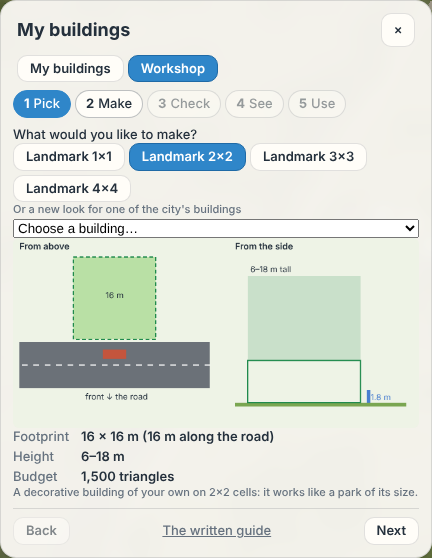
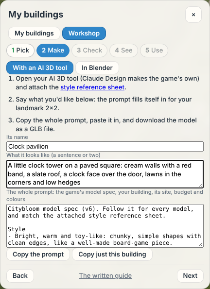
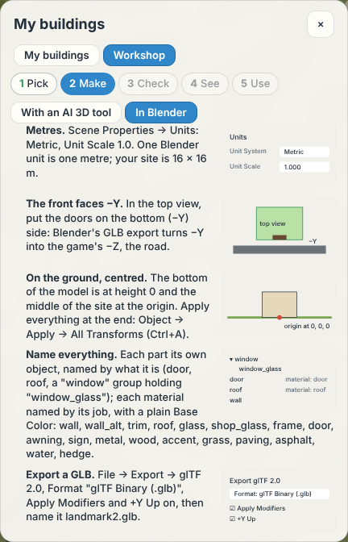
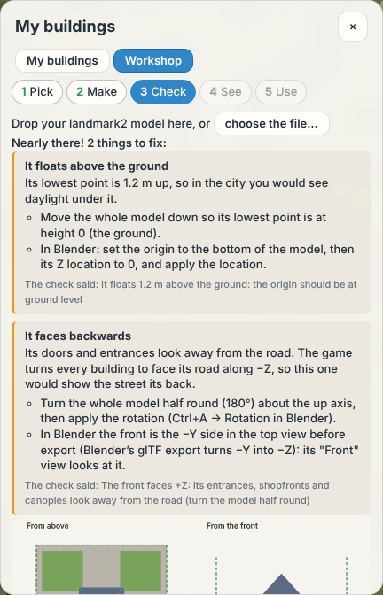
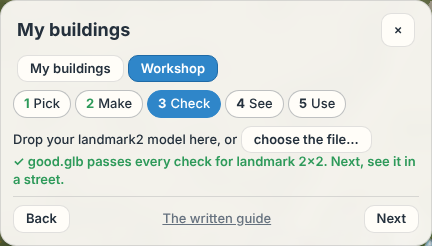
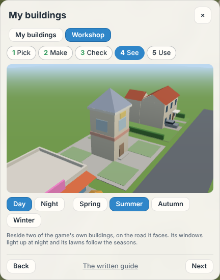
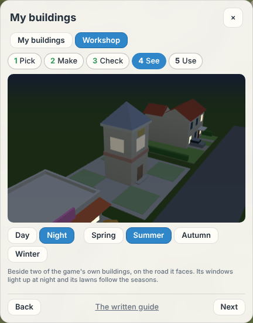
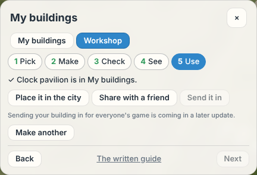
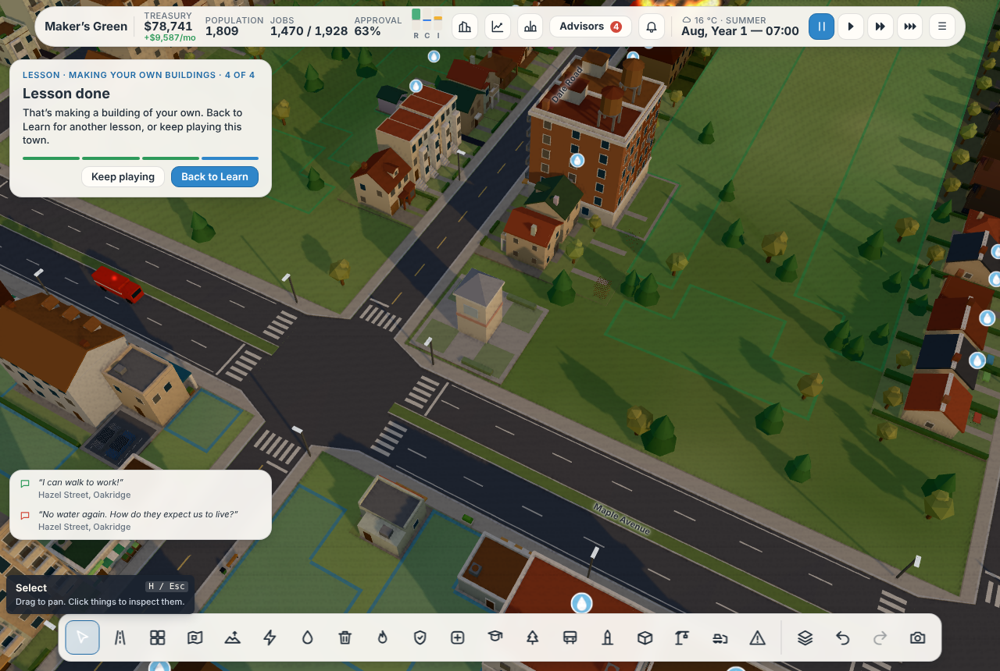

# Making your own buildings

You can make buildings of your own and put them in your city. This guide takes you from nothing to a
building standing in your town. You don't need to have made a 3D model before.

**What you can make**

- **A landmark of your own**, on 1×1 up to 4×4 cells: a bandstand, a statue, a fountain, a folly, anything
  you like. It works like a park of the same size.
- **A new look for a building you place**, like your fire station, school, power plant or pocket park. It
  still works exactly like the game's own; only its look changes.

**What you need**

- The game, open in a city (or main menu → **Create** → **My buildings**, which opens a small town with
  the Workshop ready; the **Making your own buildings** lesson under **Play** → **Learn** walks you through it).
- One of these to make the model:
  - an **AI 3D tool** that can make GLB files (the game's own buildings are made in Claude Design);
  - or **Blender**, which is free (blender.org), if you'd like to build it by hand.

## The Workshop, in five steps

Open **My buildings** (the Tourism and landmarks button on the toolbar, then **My buildings…**) and choose
the **Workshop** tab. It keeps your place if you close it.

### 1. Pick what to make

Choose a landmark size, or a building to give a new look. The Workshop shows its **footprint** (how much
ground it stands on), how **tall** it should be, and its **budget**: the most triangles it may have, so a
city full of buildings still runs smoothly.



### 2. Make the model

**With an AI 3D tool:** type its name and a sentence or two about how it looks. The Workshop writes the
whole prompt for you: the game's model spec, your building, its site, budget and the names its colours
need. Press **Copy the prompt**, paste it into your AI tool along with the **style reference sheet** (a
link in the same step), and download the model as a GLB file.



**In Blender:** the Workshop shows the five things the game needs, each with a picture: work in metres,
put the front on the −Y side, stand it on the ground at the centre, name every part and colour, and export
a GLB.



### 3. Check it

Drop the GLB file in (or choose it). The game checks it the same way it checks its own buildings. If
something's wrong, you get a note for each thing: what's wrong, why the game cares, and how to fix it,
with a picture from above and from the front (your site in green, the parts at fault in red).



Fix them, export again and drop the new file in. When it passes, you'll see a tick.



### 4. See it

Your building on its lot, beside two of the game's own buildings and the road it faces. Try it by night
(its windows light up) and in each season (lawns and hedges change, snow settles on flat roofs).





### 5. Use it

**Add to My buildings**, then **Place it in the city**: click where it should stand, beside a road. A new
look goes on a building you place, or on one that's already standing: pick it on the map and choose your
model under **Look** in its panel. **Share with a friend** makes a small `.citybloom-building` file they can
add in their own My buildings (it goes through the same check). Sending your building in for everyone's
game is coming in a later update.





## A worked example: a clock pavilion

1. **Pick:** a 2×2 landmark. Its site is 16 × 16 m, it should be 6–18 m tall, and it may have 1,500
   triangles.
2. **Make:** the name "Clock pavilion" and the words "A little clock tower on a paved square: cream walls with a red band, a slate roof, a clock face over the door, lawns in the corners and low hedges". After the game's model spec, the prompt ends:

   ```text
   Citybloom model, following the model spec (v6) and style reference: Clock pavilion. Save as landmark2.glb.
   Site 16 x 16 m (16 m along the road, 16 m deep); the front is on the road, facing -Z. Budget 1,500 triangles. About 6-18 m tall.
   A little clock tower on a paved square: cream walls with a red band, a slate roof, a clock face over the door, lawns in the corners and low hedges
   ```

3. **Check, first try:** two notes. **It floats above the ground** (its lowest point was 1.2 m up) and
   **It faces backwards** (its steps and door looked away from the road). In Blender: select everything,
   move it down until its bottom sits at 0, turn it 180° round the up axis, then Object → Apply → All
   Transforms, and export again.
4. **Check, second try:** it passes.
5. **See:** it stands between a house and a shop, its lawns green in summer and white in winter.
6. **Use:** added to My buildings and placed on a corner of Maple Avenue.

## Common mistakes, and their fixes

| What the Workshop says   | What happened                                                    | The fix                                                                      |
| ------------------------ | ---------------------------------------------------------------- | ---------------------------------------------------------------------------- |
| It was made in centimetres | Every size came out 100 times too big                          | Units in metres (Scene Properties → Units), scale it down, apply the scale   |
| It faces backwards       | The doors look away from the road                                | Turn it 180° round the up axis, apply the rotation                           |
| It floats above the ground | Its lowest point isn't at 0                                    | Move it down to 0, apply the location                                        |
| It has too many triangles | Too much small detail                                           | Remove tiny bevels and round edges; fewer sides on round things; Decimate    |
| Its parts have no names  | Parts still called Cube, Cube.001…                               | Name each part by what it is: door, roof, window_glass (in a "window" group) |
| Its colours are not named by their job | Materials called Material.001, Red…                | Rename each material to its role: wall, roof, glass, door, grass…            |
| It is not the size of its site | It doesn't reach every edge, or goes past one              | Make the ground under it exactly the site's size                             |
| It uses pictures (textures) | Image textures on the materials                               | Plain colours only                                                           |

## The model spec, in plain words

These are the rules the game's check uses, written out. The numbers come from the check itself, so this
list is always up to date.

<!-- model-spec:start (written by scripts/docs/modelSpec.ts; edit src/models/playerSpec.ts) -->

### Size and units

- Every number is in metres, with y pointing up. A storey is about 3 m (3.6 m for shops and offices).
- The model fills its site exactly, measured to within 5 cm: something (a wall, a lawn or paving) reaches each of the four edges, and nothing goes past them.
- Landmarks: 1×1: 8 × 8 m, 800 triangles; 2×2: 16 × 16 m, 1,500 triangles; 3×3: 24 × 24 m, 2,500 triangles; 4×4: 32 × 32 m, 3,500 triangles. A new look for a building takes that building's site (the Workshop shows it).

### Which way it faces

- The front faces the road, which is along −Z (in Blender, the −Y side before export: the "Front" view looks at it).
- Doors, entrances, shop windows, canopies and signs go on the front: the game works out which way a building faces from them.
- The model's origin (0, 0, 0) is the middle of the site, on the ground.

### On the ground

- The lowest point is at height 0, within 5 cm: nothing floats above the ground or sinks below it.
- Lawns, paths and paving lie flat, 5 cm to 10 cm above 0 (the game draws its own base under every building, just below them). No raised slab under the whole site.
- Nothing hangs in the air: every part stands on the ground or on another part.

### Parts and their names

- Every part is its own named object (don’t join them all into one): door, roof, wall, awning, sign, ac_unit, solar_panel…
- Each window is a group named "window" holding a pane named "window_glass" (the game lights each one at night); a strip of glass along a floor is "window_band", in pieces 3–4 m long.
- Set glass and frames 5–10 cm in front of their wall, never in it.
- Where a tree should stand, put a 1 m cube named "tree_spot" on the ground: the game puts one of its own trees there. No trees, cars or people of your own.
- Parts left with a 3D program’s own names (Cube, Cube.001) are refused: the game can’t tell a door from a roof.

### Colours

- Plain colours only: no pictures (textures), no lettering or logos.
- Each colour (material) is named by its job: **wall** (walls (the game repaints them for each copy)); **wall_alt** (a second wall colour: bands, panels, a lower storey); **trim** (white trim: cornices, sills, edges, columns); **roof** (roof surfaces only (repainted for each copy; snow settles on flat ones)); **glass** (window panes, which light up at night); **shop_glass** (shop windows, lit brighter at night); **frame** (window and door frames); **door** (doors and gates); **awning** (awnings and canopies (repainted)); **sign** (plain sign panels, no lettering (repainted)); **metal** (metal: rooftop units, posts, machinery); **wood** (wood: benches, decks, fences); **accent** (a bright detail: a clock face, a flag, a sculpture); **grass** (lawns and green roofs (they follow the seasons)); **paving** (paths, squares and steps); **asphalt** (car parks and yards); **water** (pools and fountains); **hedge** (hedges and planters (they follow the seasons)).
- Use the colours on the style reference sheet: pastel, brick or white walls, terracotta, slate or green roofs, white trim.

### Style

- Bright, warm and toy-like: chunky, simple shapes with clean edges, like a board-game piece.
- Nothing thinner than about 30 cm (no railings, cables or thin poles): it reads from above.
- Your own design: nothing copied from a real landmark, a brand or another game.

### The file

- One GLB file ("glTF Binary"), with everything inside it: nothing in other files.
- At most 1 MB, and within the triangle budget of what it is (above for landmarks; the Workshop shows a building's).

<!-- model-spec:end -->

## Good to know

- **Where your buildings are kept:** in this browser, on this device. A city you save keeps the buildings
  it uses, so it opens with them anywhere (and a region's friends see them when they visit).
- **Friends:** in a shared city your friends see your buildings, and you see theirs. **Show friends' custom
  buildings** in My buildings turns theirs off for you, and the host can turn custom buildings off for the
  room.
- **Safe for friends:** your buildings only go to friends in rooms you share, and nothing is kept on the
  game's server.
- **The game's own prompts:** `docs/models/PROMPTS-WAR.md` shows how the game's buildings were asked for,
  if you'd like more examples.
